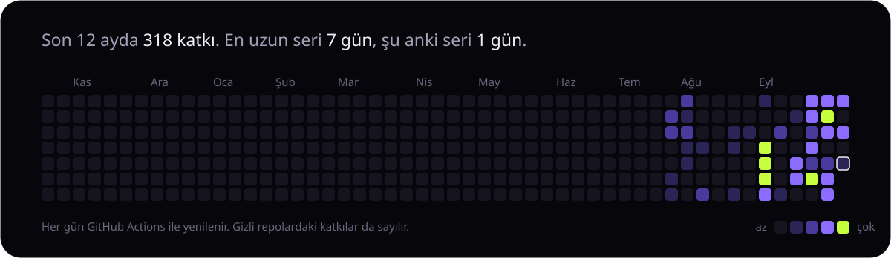

Merhaba, ben MaMi. Bir fikrin arayüzünü de, arkasındaki sunucuyu da yazıyorum; sonra kendi kurduğum altyapıda yayına alıyorum. Projelerimin çoğu müşteri işi ya da kişisel olduğu için gizli, burada neler yaptığımı özetliyorum.

### Neler yapıyorum

**Web siteleri**  
Hızlı açılan, arama motorlarına uygun, harita ve veri ağırlıklı React ve TypeScript siteleri.

**Paneller ve izleme**  
Sunucuları, sanal makineleri, ağ cihazlarını ve kameraları tek ekrandan izleyen NOC panelleri; kesintiyi kök nedeniyle gösteren yönetim ekranları.

**Discord botları**  
[sysmami](https://sysmami.com): kayıttan ekonomiye sunucunun işini gören dokuz botluk bir ekip ve onu yöneten web paneli.

**Altyapı**  
Proxmox ve Ubuntu sunucular, Docker, Cloudflare. Projelerimi kendi kurduğum sunucularda barındırıyor, güncellemelerini otomatikleştiriyorum.

### Kullandıklarım

**Arayüz**  

**Sunucu ve veri**  

**Altyapı ve araçlar**  

### Hareket

### Ulaşmak için

Discord'da **m.a.m.1** ([profil](https://discord.com/users/836876485704941568)) en hızlı yol. E-posta: [mami.hub37@gmail.com](mailto:mami.hub37@gmail.com). Bot paketleri için [sysmami.com](https://sysmami.com).
